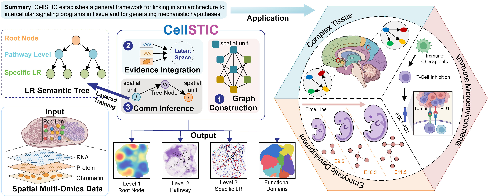
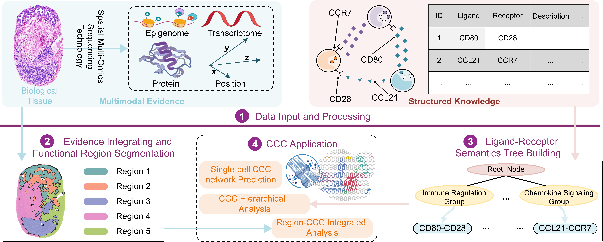

# CellSTIC

Decoding hierarchical cell-cell communication in spatial multi-omics with
CellSTIC.

<p align="center">
  
</p>

## Method

CellSTIC integrates spatial multi-omics, spatial domain segmentation, and
ligand-receptor relationships to infer hierarchical cell-cell communication.

<p align="center">
  
</p>

## Documentation

Each top-level document has one distinct role:

| Document | Scope |
|---|---|
| [PIPELINE.md](PIPELINE.md) | Canonical operational guide: input fields, dimensions, configuration, graph construction, training, inference, output files, and API hand-offs. |
| [MODEL_CARD.md](MODEL_CARD.md) | Scientific and responsible-use description: intended use, model scope, evaluation context, limitations, ethics, and reproducibility considerations. |
| README.md | Project landing page: overview, installation, documentation navigation, repository structure, and license. |

Dataset-specific acquisition and assembly details remain in
`paper/data/<dataset>/README.md`. Those files do not redefine the shared model
pipeline.

## Installation

```bash
conda env create -f environment.yml
conda activate cellstic
```

Run commands from the repository root.

## Start an analysis

Follow [PIPELINE.md](PIPELINE.md) for the public `pipeline.run_cellstic` API,
input preparation, configuration, training, inference, generated files, and
analysis hand-off.

| Workspace | Intended use |
|---|---|
| `example/` | User-facing examples for applying CellSTIC to external datasets; place or link example inputs under `example/data/`. |
| `paper/` | Manuscript dataset documentation, data assembly scripts, and analysis-ready tutorials. |

These workspaces are deliberately separate: `example/` demonstrates general
use on user-provided data, whereas `paper/` documents the analyses reported in
the manuscript.

The executable [external-data tutorial](example/example.ipynb) uses the full
SPOTS mouse spleen replicate 1 dataset (2,653 spots; spatial RNA--ADT) from GEO
GSE198353. It covers checksum validation, quality control, AnnData assembly,
modality-aware preprocessing, training, result export, and downstream domain,
CCC, and hierarchy analysis. No spots or molecular features are sampled; source
provenance is documented in [example/data/README.md](example/data/README.md).
Training is commented out by default. Running the analysis cells reads the
saved model under `example/cellstic/`; uncomment training only to fit a new
model. Generated results are local artifacts and are excluded from Git.

The [manuscript dataset tutorials](paper/notebook/) also start with optional,
commented training and include executed analysis figures and tables. Their
analyses reuse the existing dataset `cellstic/` output locations. Temporal and
simulation helpers are in `utils/analysis/`; spatial plots reuse the existing
visualization utilities. Figures and source tables use the shared `domain/`,
`ccc/`, and `alluvial/` folders; temporal results are grouped by analysis under
`cellstic/time/`.

## Project structure

| Directory | Description |
|---|---|
| `model/` | Model, graph modules, hierarchy tree, and training code |
| `pipeline/` | End-to-end training, export, and analysis APIs |
| `example/` | End-to-end external-data tutorial, complete public SPOTS input data, and locally generated CellSTIC output |
| `paper/` | Manuscript dataset documentation, preprocessing, and tutorials |
| `paper/data/` | Manuscript dataset documentation and local data directories |
| `paper/preprocess/` | Raw-to-AnnData assembly for manuscript datasets |
| `paper/notebook/` | Reviewer-facing, analysis-ready manuscript dataset tutorials |
| `utils/` | Data, visualization, metric, and model-integration utilities (`utils/visualization/` contains plotting helpers) |
| `resources/` | CellChat databases and optional local annotation/semantic resources |
| `PIPELINE.md` | Canonical pipeline, input, output, and hand-off specification |

## License

GNU General Public License v3.0. See [LICENSE](LICENSE).
